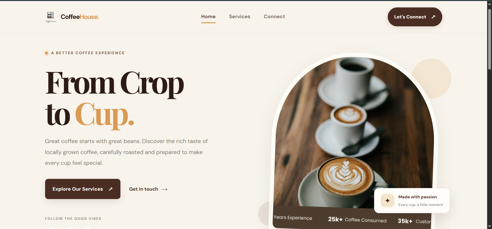

# ☕ Coffee House

### From Crop to Cup — A Better Coffee Experience

A modern and responsive coffee shop landing page designed to deliver a warm, elegant, and engaging user experience. Built with HTML5 and CSS3, this project combines a coffee-inspired color palette, clean layouts, smooth transitions, and modern web design techniques.

---


## 📸 Project Preview



---

## 🚀 Live Demo

**[☕ View Live Demo](https://ehsan-elahi-dev.github.io/coffee-house/)**

---

## ✨ Features

- ☕ Modern coffee shop landing page
- 🎨 Warm, coffee-inspired color palette
- 📱 Responsive layout for different screen sizes
- 🧭 Clean and intuitive navigation
- ✨ Smooth CSS transitions and hover effects
- 🖼️ Elegant visual presentation
- 🔤 Carefully selected typography
- 🧩 Reusable layout components
- ♿ Semantic HTML structure
- ⚡ Lightweight implementation without unnecessary dependencies
- 🛠️ Easy to maintain and customize

---

## 🛠️ Built With

- **HTML5** — Semantic page structure
- **CSS3** — Styling, layouts, and visual effects
- **Flexbox** — Flexible and aligned layouts
- **CSS Grid** — Structured page layouts
- **CSS Transitions** — Smooth interactive effects
- **Google Fonts** — Modern typography

---

## 🎯 Project Goals

The main goal of this project was to build an attractive coffee shop website while practicing essential front-end development skills.

Through this project, I focused on:

- Creating a clean and consistent user interface
- Improving CSS layout and styling skills
- Organizing HTML and CSS for maintainability
- Applying responsive design principles
- Building a visually appealing landing page
- Improving attention to spacing, typography, and colors

---

## 💻 Run Locally

You can run this project locally in just a few steps.

**1. Clone the repository**

```bash
git clone https://github.com/ehsan-elahi-dev/EMA-p11.git
```

**2. Navigate to the project directory**

```bash
cd EMA-p11
```

**3. Open the project**

Open `index.html` in your browser, or use the Live Server extension in Visual Studio Code.

No package installation or build process is required.

---

## 📂 Project Structure

```text
EMA-p11/
├── assets/
│   └── screenshot/
│       └── coffee-house.png
├── index.html
├── style.css
└── README.md
```

_Note: Update the structure above if your project contains additional files or folders._

---

## 🌱 Future Improvements

- Add a functional coffee menu
- Introduce interactive product cards
- Add a shopping cart experience
- Improve accessibility and keyboard navigation
- Add subtle scroll animations
- Connect a contact form to a backend service

---

## 👨‍💻 Author

**Ehsan Elahi**

Front-End Developer

- GitHub: [@ehsan-elahi-dev](https://github.com/ehsan-elahi-dev)
- Instagram: [@eh3an.\_.elahi](https://www.instagram.com/eh3an._.elahi/)
- Telegram: [@Eh3an_elahi](https://t.me/Eh3an_elahi)

---

<p align="center">
  Made with ☕ and passion for web development.
</p>
